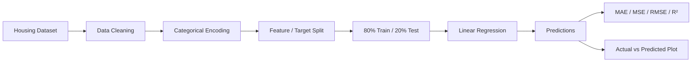

<div align="center">

# 🏠 House Price Prediction in Aden City

### Machine Learning Regression for Residential Property Price Estimation in Aden, Yemen

**Python · pandas · scikit-learn · Matplotlib · Excel/CSV**


A focused machine learning project that builds an end-to-end regression pipeline to estimate residential property prices in **Aden City** from structured housing features.

</div>

---

## 📌 Executive Summary

House prices depend on multiple interacting factors such as property size, room count, age, and location. This project explores whether a supervised machine learning model can learn those relationships from structured housing data and produce useful price estimates for properties in Aden.

The project implements a complete baseline workflow:

**Data loading → cleaning → categorical encoding → train/test split → model training → evaluation → visualization → prediction**

Using the included 120-property dataset and an 80/20 split, the Linear Regression baseline achieved an **R² score of 0.98395** on the held-out test set.

> **Portfolio purpose:** Demonstrates practical skills in supervised machine learning, regression, data preprocessing, model evaluation, and Python-based data analysis on a locally relevant problem.

---

## 🎯 Problem Statement

Residential price estimation is a classic regression problem: given measurable characteristics of a property, estimate its market price.

For this project, the model uses five predictive features:

- Property area
- Number of rooms
- Number of bathrooms
- Property age
- District in Aden

The target variable is the property's **price**.

---

## 💡 Solution Approach

The project uses a reproducible supervised-learning pipeline built with **scikit-learn**.



### Pipeline Steps

1. Load housing data from Excel.
2. Remove incomplete rows.
3. Encode categorical district values numerically.
4. Separate predictors from the target price.
5. Split data into training and testing subsets.
6. Train a Linear Regression model.
7. Generate predictions on unseen test data.
8. Evaluate performance using standard regression metrics.
9. Visualize actual versus predicted prices.
10. Use the trained model for a new-property prediction example.

---

## 📊 Dataset

The repository includes the same housing dataset in both **CSV** and **Excel** formats.

### Dataset Profile

| Item | Value |
|---|---:|
| Records | **120** |
| Columns | **6** |
| Predictive features | **5** |
| Target variables | **1** |
| Missing values | **0** |
| Training records | **96** |
| Test records | **24** |
| Districts represented | **4** |

### Features

| Feature | Type | Description |
|---|---|---|
| `area` | Numeric | Property area |
| `rooms` | Numeric | Number of rooms |
| `bathrooms` | Numeric | Number of bathrooms |
| `age` | Numeric | Property age |
| `district` | Categorical | District within Aden |
| `price` | Numeric | **Prediction target** |

### District Coverage

The dataset contains properties from:

- **Crater** — 37 records
- **Al-Maalla** — 33 records
- **Sheikh Othman** — 26 records
- **Mansoura** — 24 records

### Price Range in the Included Dataset

| Statistic | Price |
|---|---:|
| Minimum | **62,691** |
| Median | **136,978.5** |
| Mean | **138,168.36** |
| Maximum | **220,941** |

> The included dataset is intended for educational and experimental machine learning work. It should not be treated as an authoritative real-estate market dataset or production valuation source.

---

## 🤖 Model

### Baseline Algorithm

**Linear Regression** from `scikit-learn`

The goal of the baseline is to establish a simple, interpretable reference model before moving to more complex algorithms.

### Train/Test Strategy

```python
train_test_split(
    X,
    y,
    test_size=0.2,
    random_state=42
)
```

- **80% training data:** 96 records
- **20% test data:** 24 records
- `random_state=42` ensures reproducibility of the split.

---

## 🏆 Model Performance

The validated baseline produced the following test-set results:

| Metric | Result |
|---|---:|
| **R² Score** | **0.98395** |
| **Mean Absolute Error (MAE)** | **3,836.66** |
| **Root Mean Squared Error (RMSE)** | **4,416.94** |
| **Mean Squared Error (MSE)** | **19,509,336.57** |

### Interpretation

**R² = 0.98395** means that, on this held-out test split, the model explains approximately **98.4% of the variance** in the target prices contained in the project dataset.

The MAE indicates an average absolute prediction error of approximately **3,837 price units** on the evaluated test set.

> These results describe performance on the included dataset only. They do **not** establish real-world market valuation accuracy and should not be generalized without additional data and external validation.

---

## 📈 Evaluation Strategy

The project evaluates the model with multiple complementary regression metrics.

### Mean Absolute Error — MAE

Measures the average absolute difference between predicted and actual prices.

**Lower is better.**

### Mean Squared Error — MSE

Squares prediction errors before averaging them, making larger errors more influential.

**Lower is better.**

### Root Mean Squared Error — RMSE

The square root of MSE, placing the error back on the same numerical scale as the target variable.

**Lower is better.**

### R² Score

Measures the proportion of target variance explained by the model.

**Closer to 1.0 is better.**

---

## 📉 Visualization

The project generates an **Actual vs. Predicted Prices** scatter plot to provide a visual assessment of model fit.

```text
Ideal behavior:

Predicted Price
      ↑
      |          •
      |       •
      |    •
      |  •
      |•
      +----------------→ Actual Price

Predictions closer to the diagonal indicate better agreement
between actual and predicted values.
```

This complements the numeric metrics by making large deviations easier to identify visually.

---

## 🧠 What the Model Learns

The fitted baseline coefficients provide an interpretable view of the linear relationships learned from the dataset.

| Feature | Approx. learned coefficient |
|---|---:|
| `area` | **+593.02** |
| `rooms` | **+8,751.99** |
| `bathrooms` | **+6,815.79** |
| `age` | **−587.98** |
| `district`* | **−1,042.55** |

\* `district` is currently label-encoded, so its coefficient should **not** be interpreted as a true ordinal market effect. A production-quality version should use a more appropriate categorical encoding strategy such as one-hot encoding.

This section is included for model interpretability, not to claim causal relationships.

---

## 🛠️ Tech Stack

| Technology | Purpose |
|---|---|
| **Python** | Core implementation |
| **pandas** | Data loading and preprocessing |
| **scikit-learn** | Model training, splitting, encoding, and evaluation |
| **Matplotlib** | Model-performance visualization |
| **Excel / CSV** | Dataset storage |

---

## 📂 Project Structure

```text
House-Price-Prediction-in-Aden-City/
│
├── Aden Housing Data.csv
├── Aden Housing Data.xlsx
├── main.py
└── README.md
```

---

## 🚀 Getting Started

### 1. Clone the Repository

```bash
git clone <repository-url>
cd House-Price-Prediction-in-Aden-City
```

### 2. Create a Virtual Environment

```bash
python -m venv .venv
```

### 3. Activate the Environment

#### Windows PowerShell

```powershell
.\.venv\Scripts\Activate.ps1
```

#### macOS / Linux

```bash
source .venv/bin/activate
```

### 4. Install Dependencies

```bash
pip install pandas scikit-learn matplotlib openpyxl
```

### 5. Run the Project

```bash
python main.py
```

The script trains the model, calculates evaluation metrics, prints sample predictions, and displays an Actual vs. Predicted Prices plot.

---

## 🔬 Reproducibility

The project uses a fixed random seed for the train/test split:

```python
random_state=42
```

This ensures that the same 96 training samples and 24 testing samples are selected each time the pipeline is run against the same dataset and preprocessing logic.

---

## ⚠️ Current Implementation Notes

The current repository contains two small code-level issues that should be corrected before treating the repository as fully runnable end to end:

1. The dataset target column is named `price`, while `main.py` currently references `Price`.
2. The trained model uses five features, while the current `new_house` prediction example provides only four values.

These are implementation cleanup items rather than modeling issues. The baseline metrics reported in this README were reproduced using the intended pipeline with the correct `price` target column.

---

## 🔍 Limitations

This is a baseline educational ML project, not a production valuation system.

Current limitations include:

- Small dataset size (**120 records**).
- Coverage limited to four Aden districts.
- No external validation dataset.
- No cross-validation in the current implementation.
- Linear Regression may miss non-linear relationships.
- District is label-encoded rather than one-hot encoded.
- No automated feature pipeline or model persistence.
- No automated test suite.
- No uncertainty/confidence interval around predictions.
- Important real-estate variables such as exact geolocation, property condition, floor, amenities, transaction date, and proximity to services are not included.

---

## 🗺️ Roadmap

### Phase 1 — Repository Quality

- [ ] Fix target-column naming in `main.py`
- [ ] Fix the new-property prediction example
- [ ] Add `requirements.txt`
- [ ] Add input validation
- [ ] Save evaluation figures to an `assets/` directory

### Phase 2 — Better ML Pipeline

- [ ] Replace label encoding with `OneHotEncoder`
- [ ] Use `ColumnTransformer` + `Pipeline`
- [ ] Add K-Fold cross-validation
- [ ] Compare multiple regression algorithms
- [ ] Add feature importance / model interpretation

### Phase 3 — Model Comparison

Candidate models:

- Random Forest Regressor
- Gradient Boosting Regressor
- XGBoost / LightGBM where appropriate
- Regularized linear models such as Ridge and Lasso

### Phase 4 — Productization

- [ ] Persist the best model
- [ ] Create a Streamlit or web interface
- [ ] Add automated tests
- [ ] Add prediction logging
- [ ] Add a richer dataset and external validation

---

## 💼 Skills Demonstrated

This project demonstrates hands-on experience with:

- Supervised Machine Learning
- Regression Modeling
- Data Cleaning
- Feature Preparation
- Categorical Encoding
- Train/Test Evaluation
- Regression Metrics
- Model Interpretation
- Data Visualization
- Python
- pandas
- scikit-learn

---

## 🌍 Why Aden?

Many public machine learning examples reuse the same global datasets. This project applies core ML concepts to a **locally relevant context in Aden, Yemen**, showing how standard data-science methods can be adapted to regional problems and datasets.

The long-term value of the project is not just the baseline model itself, but the pathway toward richer local datasets, stronger validation, and eventually a more realistic decision-support tool for residential property analysis.

---

## 📌 Portfolio Positioning

Within my portfolio, this project represents the **Machine Learning & Data Analytics** layer of my work.

It complements projects focused on:

- AI Agents
- Retrieval-Augmented Generation (RAG)
- Intelligent Automation
- Applied AI Systems

Together, these projects demonstrate the ability to work across the AI application lifecycle — from structured-data modeling to modern LLM-powered systems.

---

## 👤 Author

**Mohammed Tariq**  
AI Solutions Developer

> Building AI agents, RAG systems, intelligent automation, machine learning solutions, and data-driven applications for real-world problems.

---

<div align="center">

### ⭐ If you find this project useful, consider starring the repository.

**Machine Learning · Data Analytics · Applied AI · Aden, Yemen**

</div>
